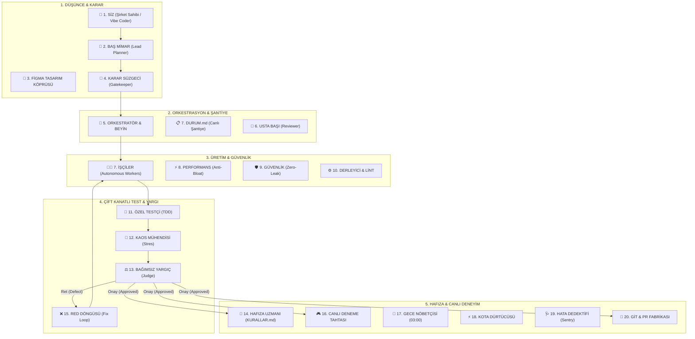

# 🏛️ Vigiles Engine
### Kurşungeçirmez 20 Elemanlı Otonom Yazılım Şirketi ve Canlı Telemetri Merkezi

[](./Run-MasterVerification.ps1)
[](https://antigravity.google)
[](#-sistem-mimarisi)
[](#-canlı-operasyon-merkezi-mission-control)
[](#-g%C3%BCvenlik-ve-performans-muhaf%C4%B1zlar%C4%B1)

> **Google Antigravity'yi sıradan bir kod tamamlama asistanından, kendi kendine plan çizen, test yazan, stres saldırısı yapan, denetleyen, kalıcı hafızasına ders çıkaran ve canlı operasyon merkezinde gerçek zamanlı izlenebilen kurumsal bir yazılım fabrikasına dönüştüren otonom mühendislik protokolü.**

---

## 🌟 Neden Vigiles Engine?

Antik Roma'da şehri gece gündüz koruyan muhafızlardan (*Vigiles Urbani*) ilham alan **Vigiles Engine**, geleneksel yapay zeka asistanlarının pasif "prompt-cevap" sığlığını yıkar. Sisteminize bir **Staff/Principal Software Engineer ve Operasyon Orkestratörü** gibi yaklaşır:

1. **Kör Kodlama Yasağı (Never Code Blindly):** Mimari plan ve kabul kriterleri (`DURUM.md`) çizilmeden tek satır kod yazılmaz.
2. **Kapalı Döngü TDD (Closed-Loop TDD):** İşçi kod yazmadan önce Özel Testçi testleri yazar. Testler patlarsa hatayı kullanıcıya sormadan kendi düzeltir.
3. **Kaos ve Stres Denetimi (Chaos Engineering):** Her servis çift harcama, yarış durumu (race condition), kaba kuvvet (brute-force) ve eksi bakiye saldırılarına maruz bırakılır.
4. **Gerçek Zamanlı Çekirdek Kancaları (Engine Hooks):** Ajanın manuel dosya düzenlemesine gerek kalmadan, işletim sistemi düzeyindeki `PreToolUse` kancalarıyla her eylem anında yakalanır.
5. **Canlı Görev Merkezi (Live Mission Control):** Arka plandaki SSE sunucusu üzerinden (`http://localhost:9999/`) tüm fabrikanın hangi adımda çalıştığı, daktilo logları ve ses efektleriyle canlı izlenir.

---

## 📐 Sistem Mimarisi



---

## 👥 20 Elemanlı Kadro Özeti

| # | Rol | Uzmanlık Alanı |
| :-: | :--- | :--- |
| **1** | **SİZ (Şirket Sahibi)** | Nihai vizyonu çizer, interaktif deneme tahtasında ürünü inceler. |
| **2** | **BAŞ MİMAR** | Kabul kriterlerini ve sözleşmeyi `DURUM.md` şantiye defterine bağlar. |
| **3** | **FİGMA KÖPRÜSÜ** | HEX renk kodları, fontlar ve padding değerlerini koda aktarır. |
| **4** | **KARAR SÜZGECİ** | Tek yönlü (Tip 1) geri dönülmez kararlarda kullanıcıya pop-up sorar. |
| **5** | **ORKESTRATÖR** | Görevleri parçalar, alt ajanları (subagents) izole branch'lere dağıtır. |
| **6** | **USTA BAŞI** | Kod hijyeni, Clean Architecture ve SOLID prensiplerini denetler. |
| **7** | **İŞÇİLER** | TDD kırmızı fazını yeşile çevirecek üretim kodunu yazar. |
| **8** | **PERFORMANS (Anti-Bloat)** | 15MB+ şişkin kütüphaneleri ve gereksiz N+1 sorguları kilitler. |
| **9** | **GÜVENLİK (Zero-Leak)** | Kod içine açık API anahtarı veya secret yazılmasını engeller. |
| **10** | **DERLEYİCİ & LİNT** | Tip ve derleme hatalarını terminalden doğrular. |
| **11** | **ÖZEL TESTÇİ** | Kod yazılmadan önce birim ve entegrasyon testlerini yazar. |
| **12** | **KAOS MÜHENDİSİ** | Eşzamanlı çekim, sınır aşımı ve bellek sızıntısı saldırıları düzenler. |
| **13** | **BAĞIMSIZ YARGIÇ** | Zero-Trust denetimiyle tüm kanıtları inceler, ONAY MÜHRÜ basar. |
| **14** | **HAFIZA UZMANI** | Öğrenilen kurumsal dersleri `KURALLAR.md` anayasasına işler. |
| **15** | **RED DÖNGÜSÜ** | Yargıç reddederse açık kusur kartı açar ve işçileri düzeltmeye zorlar. |
| **16** | **CANLI DENEME TAHTASI** | İş teslim edilince yan panelde açılan canlı HTML simülatörü sunar. |
| **17** | **GECE NÖBETÇİSİ** | Gece 03:00'te uykuda refactoring ve güvenlik devriyesi yapar. |
| **18** | **KOTA DÜRTÜCÜSÜ** | Uzun görevlerde oturumu uyanık tutmak için minimum ping atar. |
| **19** | **CANLI HATA DEDEKTİFİ** | Sentry canlı hata loglarını otomatik olarak TDD testine dönüştürür. |
| **20** | **GİT & PR FABRİKASI** | Özellik branch'i açar, konvansiyonel commit ve PR özeti üretir. |

---

## 🛰️ Canlı Operasyon Merkezi (Mission Control)

Tarayıcınızda açıp arkadaki fabrikayı canlı izleyebileceğiniz Server-Sent Events (SSE) tabanlı kontrol merkezi:

* **Adres:** `http://localhost:9999/`
* **Yedek Görünüm:** `ui/live_mission_control.html`
* **Akıcı Olay Kuyruğu (Pacing Queue):** Ajan 2 saniyede 10 araç çalıştırsa bile arayüz her adımı en az 1.2 saniye boyunca odaklayarak sinematik bir akış sunar. Karar Süzgeci pop-up'ı geldiğinde siz yanıt verene kadar kilitlenir.

---

## 🎮 Canlı Deneme Tahtası (Live Playground)

* **Adres:** `http://localhost:9999/playground`
* **Yedek Görünüm:** `ui/live_playground.html`
* **Özellik:** Tamamlanan servisleri (Cüzdan, Kupon, İki Aşamalı Doğrulama) tarayıcınızda tek tıkla deneyebileceğiniz interaktif sandbox.

---

## 📂 Dizin Yapısı

```text
.
├── core/                                      # Küresel Sistem Bileşenleri
│   ├── skills/veteran/                        # 20 Elemanlı Global Yetenek & 7 Rol Kartı
│   ├── templates/                             # DURUM, KURALLAR, Playground, MCP şablonları
│   ├── scripts/                               # sentinel_guard, telemetry_server, git_pr, gece_nobetci
│   └── hooks.json                             # Antigravity Engine Lifecycle Hooks
│
├── ui/                                        # Canlı Web Arayüzleri
│   ├── system_architecture_diagram.html       # 20 Elemanlı Mimari Şeması (Orijinal)
│   ├── live_mission_control.html              # Canlı Operasyon Merkezi (SSE Port 9999)
│   └── live_playground.html                   # Canlı Deneme Tahtası (İnteraktif Sandbox)
│
├── docs/                                      # Kapsamlı Rehberler
│   ├── veteran_system_master_handbook.md      # Büyük Sistem El Kitabı
│   ├── antigravity_mastery_playbook.md        # Antigravity İleri Seviye Playbook
│   └── live_mission_control_evolution_plan.md # Telemetri Evrim Planı
│
├── DURUM.md                                   # Canlı Şantiye Defteri (Son Görev & Onay Mührü)
├── KURALLAR.md                                # Şirket Anayasası (KURAL-001 - KURAL-006)
├── install.ps1                                # Tek Tıkla Kurulum Betiği
├── Run-MasterVerification.ps1                 # Konsolide 7/7 Büyük Sistem Doğrulayıcı
│
├── AuthService.ps1 & Test-Auth.ps1            # Kimlik Doğrulama Servisi (TDD)
├── CouponService.ps1 & Test-Coupon.ps1        # Kupon Motoru (TDD)
├── WalletService.ps1 & Test-Wallet.ps1        # Dijital Cüzdan (Strict Cap Korumalı)
├── TwoFactorService.ps1 & Test-TwoFactor.ps1  # 2FA / OTP Servisi (60s TTL & Rate Limit)
└── Chaos-Coupon.ps1, Chaos-Wallet.ps1, Chaos-TwoFactor.ps1 # Kaos Saldırı Betikleri
```

---

## ⚡ Hızlı Kurulum ve Kullanım

### 1. Sistemin Bilgisayarınıza Kurulması
Bu repoyu klonladıktan veya indirdikten sonra PowerShell'de tek satır çalıştırmanız yeterlidir:

```powershell
.\install.ps1
```
Bu komut, `core/` altındaki tüm yetenekleri, şablonları ve güvenlik kancalarını `~/.gemini/config/` dizinine otomatik olarak yerleştirir.

### 2. Yeni Bir Projede Devreye Alma
Bilgisayarınızdaki herhangi bir klasörde Antigravity'yi açın ve sohbete şunu yazın:

```text
/vigiles
```
veya
```text
Vigiles modunda çalışmaya başla.
```

Baş Mimar anında `DURUM.md` ve `KURALLAR.md` sözleşmelerini açacak ve 20 elemanlı fabrika görevinizi kurşungeçirmez olarak üretecektir!

---

## 🧪 Konsolide Test Karnesi

| Test Paketi | Test Edilen Alan | Sonuç |
| :--- | :--- | :---: |
| `Test-Auth.ps1` | PBKDF2 Parola Hashleme & Timing-Attack Savunması | ✅ GEÇTİ |
| `Test-Coupon.ps1` | Sepet Alt Limiti, Tek Kullanımlık Kupon Doğrulama | ✅ GEÇTİ |
| `Test-Wallet.ps1` | Bakiye Yükleme, Harcama & 10.000 TL Strict Cap Sınırı | ✅ GEÇTİ |
| `Test-TwoFactor.ps1` | 6 Haneli OTP, 60s Süre Sınırı & 3 Hatalı Denemede Kilit | ✅ GEÇTİ |
| `Chaos-Coupon.ps1` | Eşzamanlı Çift Harcama Yarış Durumu (Race Condition) | ✅ PÜSKÜRTÜLDÜ |
| `Chaos-Wallet.ps1` | 10 Paralel Çekim & 1.000.000 TL Bakiye Enjeksiyonu | ✅ PÜSKÜRTÜLDÜ |
| `Chaos-TwoFactor.ps1` | 100 Seri Kaba Kuvvet (Brute-Force) & Replay Saldırısı | ✅ PÜSKÜRTÜLDÜ |
| **KONSOLİDE RAPOR** | **Tüm Sistem Bileşenleri (7/7 Paket, 0 Kusur)** | **✅ %100 BAŞARILI** |

---

## 📄 Lisans
Bu proje MIT lisansı ile lisanslanmıştır. Dilediğiniz gibi geliştirebilir, ekiplerinizle paylaşabilir veya ticari projelerinizde kullanabilirsiniz.
