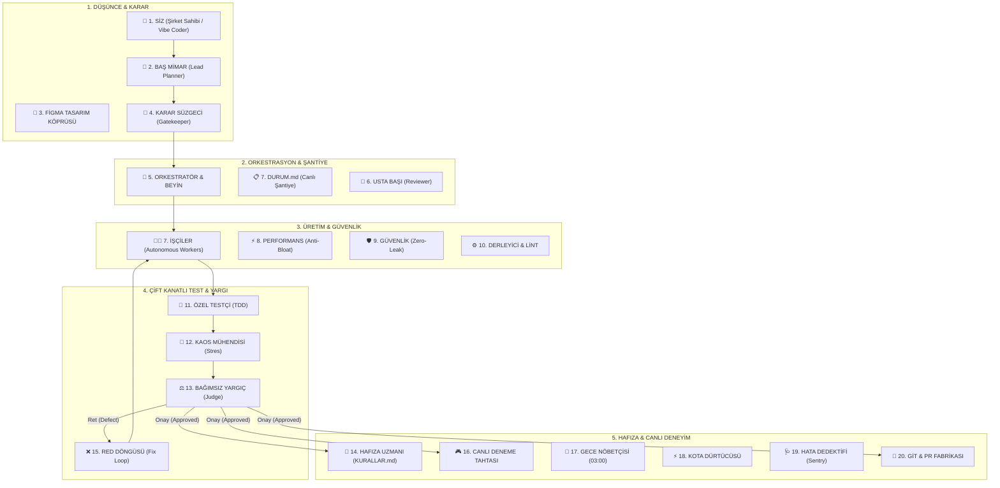

# 🏛️ Vigiles Engine
### Kurşungeçirmez 20 Elemanlı Otonom Yazılım Şirketi ve Canlı Telemetri Merkezi

[](./Run-MasterVerification.ps1)
[](https://antigravity.google)
[](#-sistem-mimarisi)
[](#-canlı-operasyon-merkezi-mission-control)
[](#-g%C3%BCvenlik-ve-performans-muhaf%C4%B1zlar%C4%B1)

> **Google Antigravity'yi sıradan bir kod tamamlama asistanından, kendi kendine plan çizen, test yazan, stres saldırısı yapan, denetleyen, kalıcı hafızasına ders çıkaran ve canlı operasyon merkezinde gerçek zamanlı izlenebilen kurumsal bir yazılım fabrikasına dönüştüren otonom mühendislik protokolü.**

---

## 🌟 Neden Vigiles Engine?

Antik Roma'da şehri gece gündüz koruyan muhafızlardan (*Vigiles Urbani*) ilham alan **Vigiles Engine**, geleneksel yapay zeka asistanlarının pasif "prompt-cevap" sığlığını yıkar. Sisteminize bir **Staff/Principal Software Engineer ve Operasyon Orkestratörü** gibi yaklaşır:

1. **Kör Kodlama Yasağı (Never Code Blindly):** Mimari plan ve kabul kriterleri (`DURUM.md`) çizilmeden tek satır kod yazılmaz.
2. **Kapalı Döngü TDD (Closed-Loop TDD):** İşçi kod yazmadan önce Özel Testçi testleri yazar. Testler patlarsa hatayı kullanıcıya sormadan kendi düzeltir.
3. **Kaos ve Stres Denetimi (Chaos Engineering):** Her servis çift harcama, yarış durumu (race condition), kaba kuvvet (brute-force) ve eksi bakiye saldırılarına maruz bırakılır.
4. **Gerçek Zamanlı Çekirdek Kancaları (Engine Hooks):** Ajanın manuel dosya düzenlemesine gerek kalmadan, işletim sistemi düzeyindeki `PreToolUse` kancalarıyla her eylem anında yakalanır.
5. **Canlı Görev Merkezi (Live Mission Control):** Arka plandaki SSE sunucusu üzerinden (`http://localhost:9999/`) tüm fabrikanın hangi adımda çalıştığı, daktilo logları ve ses efektleriyle canlı izlenir.

---

## 📐 Sistem Mimarisi



---

## 👥 20 Elemanlı Kadro Özeti

| # | Rol | Uzmanlık Alanı |
| :-: | :--- | :--- |
| **1** | **SİZ (Şirket Sahibi)** | Nihai vizyonu çizer, interaktif deneme tahtasında ürünü inceler. |
| **2** | **BAŞ MİMAR** | Kabul kriterlerini ve sözleşmeyi `DURUM.md` şantiye defterine bağlar. |
| **3** | **FİGMA KÖPRÜSÜ** | HEX renk kodları, fontlar ve padding değerlerini koda aktarır. |
| **4** | **KARAR SÜZGECİ** | Tek yönlü (Tip 1) geri dönülmez kararlarda kullanıcıya pop-up sorar. |
| **5** | **ORKESTRATÖR** | Görevleri parçalar, alt ajanları (subagents) izole branch'lere dağıtır. |
| **6** | **USTA BAŞI** | Kod hijyeni, Clean Architecture ve SOLID prensiplerini denetler. |
| **7** | **İŞÇİLER** | TDD kırmızı fazını yeşile çevirecek üretim kodunu yazar. |
| **8** | **PERFORMANS (Anti-Bloat)** | 15MB+ şişkin kütüphaneleri ve gereksiz N+1 sorguları kilitler. |
| **9** | **GÜVENLİK (Zero-Leak)** | Kod içine açık API anahtarı veya secret yazılmasını engeller. |
| **10** | **DERLEYİCİ & LİNT** | Tip ve derleme hatalarını terminalden doğrular. |
| **11** | **ÖZEL TESTÇİ** | Kod yazılmadan önce birim ve entegrasyon testlerini yazar. |
| **12** | **KAOS MÜHENDİSİ** | Eşzamanlı çekim, sınır aşımı ve bellek sızıntısı saldırıları düzenler. |
| **13** | **BAĞIMSIZ YARGIÇ** | Zero-Trust denetimiyle tüm kanıtları inceler, ONAY MÜHRÜ basar. |
| **14** | **HAFIZA UZMANI** | Öğrenilen kurumsal dersleri `KURALLAR.md` anayasasına işler. |
| **15** | **RED DÖNGÜSÜ** | Yargıç reddederse açık kusur kartı açar ve işçileri düzeltmeye zorlar. |
| **16** | **CANLI DENEME TAHTASI** | İş teslim edilince yan panelde açılan canlı HTML simülatörü sunar. |
| **17** | **GECE NÖBETÇİSİ** | Gece 03:00'te uykuda refactoring ve güvenlik devriyesi yapar. |
| **18** | **KOTA DÜRTÜCÜSÜ** | Uzun görevlerde oturumu uyanık tutmak için minimum ping atar. |
| **19** | **CANLI HATA DEDEKTİFİ** | Sentry canlı hata loglarını otomatik olarak TDD testine dönüştürür. |
| **20** | **GİT & DEPLOY KONTROLÜ** | Sıfır otomatik git prensibi; iş bitince haber verir, `/push` ile add+commit+push icra eder. |

---

## ⚡ Çift Vitesli Mimari: Vigiles Classic vs. Vigiles Light

Vigiles ekosistemi, işin büyüklüğüne ve risk seviyesine göre **iki ayrı operasyonel vites** sunar:

| Kriter | 🏛️ Vigiles Classic (`/vigiles`) | ⚡ Vigiles Light (`/lite` veya `/vigiles-light`) |
| :--- | :--- | :--- |
| **Kullanım Amacı** | Büyük özellikler, modül inşası, mimari refactor | Küçük bugfixler, ufak CSS/UI rötuşları, 1-2 dosyalık işler |
| **Hedef Süre** | 2 - 5 dakika (Kapsamlı doğrulama) | **&lt; 30 saniye (Cerrahi hız)** |
| **Ajan Mimarisi** | 21 Rol / Alt Ajanlar (`invoke_subagent`) | **0 Subagent (Tek oturumda doğrudan icra)** |
| **Planlama Modeli** | `DURUM.md` şantiye defteri + Mimar aşaması | **3 Satırlık Satır İçi (Inline) Mikro-Plan** |
| **Test & Doğrulama** | E2E + Görsel Snapshot QA + Kaos Monkey | **Hedefli Sanity Check (Sadece ilgili birim test / syntax)** |
| **HUD / Arayüz** | Port 9999 Canlı Operasyon Merkezi (`15 Aşama`) | Fast-Strike HUD (`5 Hızlı Aşama`) |
| **Güvenlik (Zero-Leak)** | ✅ Tavizsiz koruma (API key / .env engeli) | ✅ Tavizsiz koruma (API key / .env engeli) |
| **Git & Dağıtım** | ✅ Sıfır otomatik Git (`/push` ile tek komut) | ✅ Sıfır otomatik Git (`/push` ile tek komut) |

---

## 🚀 Güvenli Git Dağıtım Pipeline'ı (/push)

Vigiles Engine sisteminde **Sıfır Otomatik Git Prensibi (Zero Auto-Git)** geçerlidir. Sistem geliştirme sırasında asla kullanıcıdan habersiz veya otonom olarak `git add`, `git commit` veya `git push` komutlarını çalıştırmaz:

1. **Hazır Bildirimi:** Tüm TDD testleri, kaos testleri ve Bağımsız Yargıç onayı tamamlandığında sistem dosyaları çalışma dizininde hazır bekletir ve kullanıcıya açık bildirim sunar:
   > 🚀 **Çalışma Tamamlandı ve Doğrulandı!**  
   > Tüm testler ve doğrulamalar tamamlandı. Değişiklikleri Git'e kaydedip GitHub'a göndermek için **/push** komutunu yazabilirsiniz.
2. **Kullanıcı Kontrollü 3'ü 1 Arada Pipeline:** Kullanıcı Antigravity sohbetine `/push` (veya `/push "mesaj"`) yazdığında sistem `git_push_manager.ps1` betiğini çalıştırarak:
   - **[1. Adım]** `git add -A` (Değişiklikleri sahneye ekler)
   - **[2. Adım]** `git commit -m "..."` (Conventional Commit kaydeder)
   - **[3. Adım]** `git push origin <branch>` (GitHub'a güvenle aktarır)
   sürecini tek komutta icra eder.

---

## 🛰️ Canlı Operasyon Merkezi (Mission Control)

Tarayıcınızda açıp arkadaki fabrikayı canlı izleyebileceğiniz Server-Sent Events (SSE) tabanlı kontrol merkezi:

* **Adres:** `http://localhost:9999/`
* **Yedek Görünüm:** `core/templates/live_mission_control.html`
* **Akıcı Olay Kuyruğu (Pacing Queue):** Ajan 2 saniyede 10 araç çalıştırsa bile arayüz her adımı en az 1.2 saniye boyunca odaklayarak sinematik bir akış sunar. Karar Süzgeci pop-up'ı geldiğinde siz yanıt verene kadar kilitlenir.

---

## 🎮 Canlı Deneme Tahtası (Live Playground)

* **Adres:** `http://localhost:9999/playground`
* **Yedek Görünüm:** `core/templates/live_playground.html`
* **Özellik:** İnteraktif bileşenleri, olay günlüğünü ve koyu/açık tema uyumluluğunu tarayıcınızda tek tıkla deneyebileceğiniz genel amaçlı canlı sandbox.

---

## 📂 Dizin Yapısı

```text
.
├── core/                                      # Küresel Sistem Bileşenleri
│   ├── skills/                                # Vigiles, Consilium (/think), Lite (/lite), Live, Push
│   ├── templates/                             # Tek Kaynak Web Arayüzleri (HUD, Playground) & Şablonlar
│   ├── scripts/                               # sentinel_guard, telemetry_server, git_push_manager, heartbeat
│   └── hooks.json                             # Taşınabilir Antigravity Engine Lifecycle Hooks
│
├── tests/                                     # Konsolide Sistem, İzolasyon & Kaos Test Paketi (20 Paket)
│   ├── Test-*.ps1                             # Birim, Entegrasyon & Mod Bütünlüğü Doğrulamaları
│   ├── Scenario-*.ps1                         # Uçtan Uca Yaşam Döngüsü Senaryoları
│   └── Chaos-*.ps1                            # Yüksek Yük, Deadlock ve Yarış Durumu Testleri
│
├── docs/                                      # Kapsamlı Rehberler
│   ├── veteran_system_master_handbook.md      # Büyük Sistem El Kitabı
│   ├── antigravity_mastery_playbook.md        # Antigravity İleri Seviye Playbook
│   └── live_mission_control_evolution_plan.md # Telemetri Evrim Planı
│
├── DURUM.md                                   # Canlı Şantiye Defteri (Son Görev & Onay Mührü)
├── KURALLAR.md                                # Şirket Anayasası (KURAL-001 - KURAL-021)
├── install.ps1                                # Taşınabilir & Hook-Merge Destekli Kurulum Betiği
└── Run-MasterVerification.ps1                 # Konsolide 20/20 Sistem Doğrulayıcı
```

---

## 🏛️ Vitesler ve Komut Ekosistemi

Antigravity ortamınızı tam donanımlı bir Ar-Ge ve Yazılım Fabrikasına dönüştüren 5 operasyonel vites:

| Vites | Komut | Rol & Amaç | Kod Değiştirir mi? | Alt Ajan (Subagent)? |
| :--- | :--- | :--- | :---: | :---: |
| **Consilium (Strateji & Düşünce)** | `/think` veya `/consilium` | Kafa karışıklığı çözümü, trade-off kıyaslaması, sistem anlama (Feynman), mimari yol haritası (ADR) | ❌ **ASLA (Sıfır Mutasyon)** | 0 |
| **Vigiles Classic (Ağır İnşaat)** | `/vigiles` | Sıfırdan modül inşası, ağır refactor, TDD kapalı döngü, Kaos testi, Bağımsız Yargıç onayı | ✅ Evet (20 Elemanlı Kadro) | Dinamik (1-10+) |
| **Vigiles Light (Cerrahi Hız)** | `/lite` | Hızlı bugfix, CSS/Tailwind rötüşları, <30s müdahale, hedefli tekil sanity test | ✅ Evet (Nokta Atışı Cerrahi) | 0 |
| **Git Push Manager (Dağıtım)** | `/push` | 3 adımlı güvenli Git pipeline'ı (`add -> commit -> push`) | ❌ Yalnızca Git Dağıtımı | 0 |
| **Live Mission Control (Telemetri)** | `/live` | Port 9999 SSE telemetri HUD ve daktilo terminal ayna paneli | ❌ İzleme & Telemetri | 0 |

---

## ⚡ Hızlı Kurulum ve Kullanım

### 1. Sistemin Bilgisayarınıza Kurulması
Bu repoyu klonladıktan veya indirdikten sonra PowerShell'de tek satır çalıştırmanız yeterlidir:

```powershell
.\install.ps1
```
Bu komut, `core/` altındaki tüm yetenekleri, şablonları ve güvenlik kancalarını `~/.gemini/config/` dizinine otomatik olarak yerleştirir.

### 2. Yeni Bir Projede Devreye Alma
Bilgisayarınızdaki herhangi bir klasörde Antigravity'yi açın ve sohbete şunu yazın:

```text
/vigiles
```
veya
```text
Vigiles modunda çalışmaya başla.
```

Baş Mimar anında `DURUM.md` ve `KURALLAR.md` sözleşmelerini açacak ve 20 elemanlı fabrika görevinizi kurşungeçirmez olarak üretecektir!

---

## 🧪 Konsolide Test Karnesi

| Test Paketi | Test Edilen Alan | Sonuç |
| :--- | :--- | :---: |
| `tests/Test-GitPushManager.ps1` | Güvenli Tek Komutla Manuel Git Dağıtım Pipeline'ı (`/push`) | ✅ GEÇTİ |
| `tests/Test-Heartbeat.ps1` | 1-Token Otonom Model Kota Dürtücüsü (Heartbeat Sentinel) | ✅ GEÇTİ |
| `tests/Test-MultiSessionTelemetri.ps1` | Çoklu Chat SSE İzolasyonu ve Oturum Seçici Mekanizması | ✅ GEÇTİ |
| `tests/Test-WorkersSubNodes.ps1` | Sınırsız Dinamik İşçi Ağacı ve CSS/DOM Render Kontrolü | ✅ GEÇTİ |
| `tests/Test-AuxiliarySection.ps1` | Yardımcı & Standby Elemanlar İzolasyon Masası Kontrolü | ✅ GEÇTİ |
| `tests/Test-VigilesLightIntegrity.ps1` | Vigiles Light (`/lite`) Cerrahi Müdahale Protokol Bütünlüğü | ✅ GEÇTİ |
| `tests/Test-VigilesIsolation.ps1` | Koşullu Vigiles İzolasyonu & Sıfır Müdahale Hook Doğrulaması | ✅ GEÇTİ |
| `tests/Test-LiveIsolationSimulation.ps1` | Normal Chat vs `/vigiles` Simülasyon & Bayrak İzolasyonu | ✅ GEÇTİ |
| `tests/Test-VigilesConsiliumIntegrity.ps1` | Vigiles Consilium (`/think`) & Model Danışmanı Bütünlüğü | ✅ GEÇTİ |
| `tests/Test-ConsiliumScenarioSimulation.ps1` | `/think` Senaryo, Sıfır Kod Mutasyonu & Paket Öneri Simülasyonu | ✅ GEÇTİ |
| `tests/Test-SentinelGuardRoleDispatch.ps1` | Akıllı Rol Dağıtımı & Read-Only Komut Ayrıştırma | ✅ GEÇTİ |
| `tests/Scenario-RoleOrderLifecycle.ps1` | Uçtan Uca Faz Geçişleri & Rol Sırası Yaşam Döngüsü | ✅ GEÇTİ |
| `tests/Test-AllChatsDiscovery.ps1` | Tüm Sohbetlerin Keşfi & SQLite Köprü Doğrulaması | ✅ GEÇTİ |
| `tests/Test-ProjectPillsAndRecency.ps1` | Proje Sekme Hapları & Zamansal Sıralama Kontrolü | ✅ GEÇTİ |
| `tests/Test-PillsClickKeepOpen.ps1` | Proje Seçimi & Açık Menü Kalıcılık Etkileşimi | ✅ GEÇTİ |
| `tests/Test-AntigravityDbTitles.ps1` | `conversation_summaries.db` Saf Başlık Aynalama Doğrulaması | ✅ GEÇTİ |
| `tests/Chaos-Heartbeat.ps1` | Process Kilitlenmesi, Ağ Kopması ve Deadlock Dayanıklılığı | ✅ PÜSKÜRTÜLDÜ |
| `tests/Chaos-MultiSession.ps1` | 10 Eşzamanlı Oturum Fırtınası ve Çapraz Karışma (Cross-Talk) | ✅ PÜSKÜRTÜLDÜ |
| `tests/Chaos-WorkersSubNodes.ps1` | 50-100 İşçili Yüksek Yük Altında Taşma ve Render Dayanıklılığı | ✅ PÜSKÜRTÜLDÜ |
| `tests/Chaos-AuxiliarySection.ps1` | Yardımcı Elemanlar Fırtına & Anlık Tetikleme Dayanıklılığı | ✅ PÜSKÜRTÜLDÜ |
| **KONSOLİDE RAPOR** | **Tüm Sistem Bileşenleri (20/20 Paket, 0 Kusur)** | **✅ %100 BAŞARILI** |

---

## 📄 Lisans
Bu proje MIT lisansı ile lisanslanmıştır. Dilediğiniz gibi geliştirebilir, ekiplerinizle paylaşabilir veya ticari projelerinizde kullanabilirsiniz.
