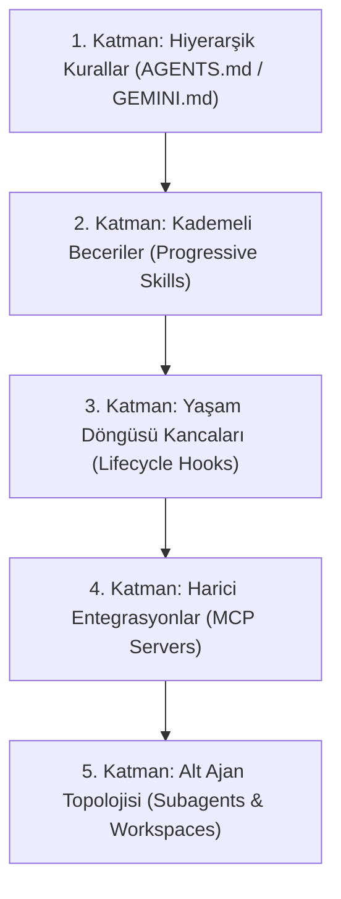
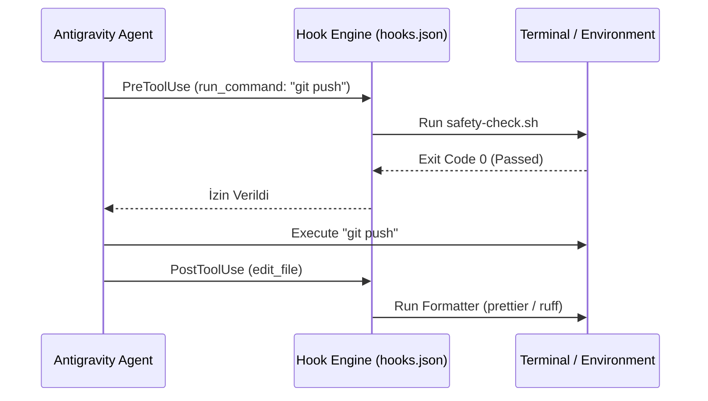

# Antigravity Veteran & Architecture Playbook
*Endüstri Standardı Agentic Sistem Mimarisi ve İleri Seviye Kullanım Kılavuzu*

---

## 1. Zihniyet Değişimi (Paradigm Shift)

Çoğu kullanıcı Antigravity'yi gelişmiş bir "kod tamamlama aracı" veya "sohbet botu" gibi kullanır. Veteran (ileri düzey) kullanıcılar ise Antigravity'ye **otonom bir Staff/Principal Pair Programmer ve Operasyon Orkestratörü** olarak yaklaşır.

```
[ Amatör Yaklaşım ]                                [ Veteran Yaklaşım ]
Prompt yaz -> Kod al -> Kopyala/Yapıştır           Hedef belirle -> Planı denetle -> Ajan yazar,
Hata alınca logu tekrar sohbete kopyala            çalıştırır, test eder, doğrular ve commit'ler.
(Ajan pasif cevaplayıcıdır)                        (Ajan aktif uygulayıcı ve doğrulatıcıdır)
```

### 3 Altın Kural
1. **Never Code Blindly (Kör Kodlama Yok)**: Karmaşık bir işe doğrudan kod yazarak başlanmaz. Önce mimari ve plan tartışılır.
2. **Closed-Loop Verification (Kapalı Döngü Doğrulama)**: Ajan kendi kodunu kendi çalıştırmalı, test etmeli ve hatayı kullanıcıya sormadan kendi düzeltmelidir.
3. **Continuous Knowledge Compounding (Kümülatif Hafıza)**: Ajan aynı hatayı iki kez yapıyorsa sorun ajanda değil, eksik `AGENTS.md` kuralında veya eksik bir `SKILL.md` dosyasındadır.

---

## 2. Endüstri Standardı 5 Katmanlı Mimari Modeli

Antigravity'de güçlü, ölçeklenebilir ve kurumsal düzeyde bir sistem kurmak için katmanlı mimari yaklaşımı kullanılır:



---

### Katman 1: Hiyerarşik Kurallar (`AGENTS.md` / `GEMINI.md`)

Kurallar ajan için değişmez yasalardır. Antigravity dizin ağacında yukarı doğru yürüyerek kuralları birleştirir.

*   **Global Seviye (`~/.gemini/config/`)**:
    *   Tüm projelerinizde geçerli olan kişisel prensipleriniz (tercih edilen dil, dokümantasyon dili, commit mesajı formatı).
*   **Proje Kök Seviyesi (`.agents/rules/` veya kök `AGENTS.md`)**:
    *   Mimari prensipler (Clean Architecture, Domain-Driven Design), test zorunluluğu, güvenlik sınırlamaları.
*   **Modül / Dizin Seviyesi (Hierarchical)**:
    *   Örneğin `frontend/AGENTS.md` içine React/Tailwind kuralları; `backend/AGENTS.md` içine FastAPI/SQLAlchemy kuralları koyabilirsiniz. Ajan o dizine girdiğinde bu kurallar dinamik yüklenir.

> [!WARNING]
> **Context Bütçesi Koruması**: Her kural dosyası en fazla 24 KB olabilir ve toplam kural bütçesi 20.000 tokendir. Kuralları "ansiklopedi" gibi yazmayın; kurallar kısa, net emirler ve negatif kısıtlamalar ("X yapma, Y yerine Z kullan") içermelidir.

---

### Katman 2: Kademeli Beceriler (Progressive Disclosure Skills)

Beceriler (`.agents/skills/<name>/SKILL.md`), ajana projenize özel standart operasyon prosedürlerini (SOP) öğretir.

#### Neden Standart Kural Yerine Skill?
Kural (`AGENTS.md`) her zaman context'te yer kaplar. **Skill ise yalnızca ihtiyaç duyulduğunda yüklenir.**
Ajan önce sadece skill adını ve açıklamasını görür (0 context maliyeti). İhtiyaç duyduğu an `SKILL.md` içeriğini, altındaki `scripts/`, `references/` ve `examples/` klasörlerini okur.

#### Standart Skill Dizin Yapısı:
```text
.agents/skills/db-migration/
├── SKILL.md              # Adı, tetiklenme şartı ve adım adım talimatlar
├── scripts/              # Ajanın çağırabileceği hazır bash/powershell scriptleri
│   └── run_migration.ps1
└── references/           # Şema kuralları, migration checklist
    └── guidelines.md
```

#### Örnek `SKILL.md`:
```markdown
---
name: db-migration
description: Use this skill whenever the user asks to create, apply, or roll back database migrations, or when altering database schemas.
---

# Database Migration Runbook

1. Değişiklik öncesi mutlaka mevcut şemanın yedeğini veya dry-run çıktısını al.
2. `./scripts/run_migration.ps1 -DryRun` komutunu çalıştır.
3. Çıktıda breaking change olup olmadığını `references/guidelines.md` kriterlerine göre denetle.
4. Testleri çalıştırarak geriye dönük uyumluluğu doğrula.
```

---

### Katman 3: Yaşam Döngüsü Kancaları (`hooks.json`)

Promptlar öneridir; **Hook'lar ise deterministik kural koyuculardır.**
`.agents/hooks.json` dosyası, ajanın araç çalıştırmadan önce (`PreToolUse`) veya sonra (`PostToolUse`) otomatik komutlar tetiklemesini sağlar.



#### Veteran Hook Kullanımları:
*   **Otomatik Kod Formatlama**: Ajan bir dosyayı düzenledikten (`edit_file`) sonra anında `eslint --fix` veya `ruff format` çalıştırmak.
*   **Güvenlik Muhafızı**: Ajanın `rm -rf`, `DROP TABLE`, ya da `main` branch'ine doğrudan push yapmasını engellemek.
*   **Regression Guard**: Önemli dosyalara dokunulduktan hemen sonra ilgili birim testleri koşturmak.

---

### Katman 4: MCP (Model Context Protocol) Ekosistemi

Veteran bir geliştirici ajanı sadece lokal dosya düzenleyici olarak bırakmaz. Ajanı tüm mühendislik altyapısına bağlar:

*   **Veritabanı MCP (`sqlite`, `postgres`)**: Ajanın sorgu atıp gerçek veri yapılarını, foreign key'leri ve performansı incelemesi.
*   **Gözlemlenebilirlik (Sentry, Datadog)**: Canlı ortamdaki log ve stack trace'leri doğrudan ajanın çekip analiz etmesi.
*   **Issue Tracker & Docs (Linear, Jira, Confluence, GitHub)**: Görev kartlarını okuma, branch açma ve PR bağlama.
*   **Figma MCP**: Tasarım token'larını ve arayüz bileşenlerini doğrudan CSS/koda çevirme.

---

### Katman 5: Alt Ajan (Subagent) Orkestrasyonu

Büyük projelerde en ölümcül hata: **Tüm işi tek bir ana sohbette yapmaya çalışmaktır.**

Uzun bir oturumda context doldukça (100k+ token), modelin "dikkat dağılması" (attention dilution) başlar; halüsinasyon artar ve küçük talimatları unutur.

#### Veteran Çözümü: Ayrık Görev Topolojisi
*   **`research` Subagent**: Geniş kod taramaları, 50 farklı dosyayı inceleme işini ana sohbete taşımayın. Araştırmacı subagent'a devredin; o okusun ve size 1 sayfalık damıtılmış özet dönsün.
*   **Branch/Share Workspaces**: Riskli veya deneysel bir refactoring mi yapacaksınız? `Workspace: 'branch'` modunda bir subagent açın; izole bir ortamda denesin, testler geçerse ana koda birleştirin.
*   **Self Subagent**: Arka planda çalışacak test suite koşturma veya uzun süreli veri işleme görevlerini bağımsız bir oturuma verip asenkron devam edin.

---

## 3. Veteran Mühendislik İş Akışları (SOPs)

### A. Planlamadan Asla Başlama (Plan-Driven Execution)
*   **`/plan`**: Karmaşık bir özellik istendiğinde hemen kod yazmayın. Önce ajana detaylı bir uygulama planı hazırlatın.
*   **`/grill-me`**: Planın açıkta kalan yönlerini (edge case'ler, cache stratejisi, failure senaryoları) ajanla karşılıklı mülakat formatında sorgulayın.
*   **`/boost`**: Kritik algoritmik veya mimari kararlarda derin düşünme ve çoklu bakış açısı modunu devreye alın.

### B. Kapalı Döngü TDD (Test-Driven Agentic Development)
1. **Red**: Ajan önce yeni özelliğin gereksinimlerini belirleyen testleri yazar (testler patlar).
2. **Green**: Ajan kodu uygular ve terminalden testleri koşturur.
3. **Refactor**: Testler geçerse kod temizlenir, dokümante edilir ve hook'lar devreye girer.
4. **Autonomous Fix**: Test patlarsa logu kullanıcıya sormak yerine ajan kendisi okur, hatayı analiz eder ve kodu düzeltir.

### C. Context Hijyeni (Context Window Hygiene)
*   **Log Kirliliğine Son**: Ajanın `npm test` diyerek 10.000 satırlık log basmasına izin vermeyin. `npm test -- --bail` veya `pytest -k test_target` gibi spesifik çalıştırın.
*   **`/compact` Kullanımı**: Bir feature tamamlandığında veya konu değiştiğinde gereksiz konuşma geçmişini sıkıştırıp context'i boşaltın.
*   **Scratchpad**: Geçici debug script'lerini proje koduna değil, `scratch/` klasörüne yazdırın.

---

## 4. Örnek Kurulum Şablonu (Production Ready)

Projenizin kök dizinine şu yapıyı kurarak sistemi kurumsal seviyeye çıkarabilirsiniz:

```text
my-project/
├── .agents/
│   ├── rules/
│   │   ├── architecture.md      # Katmanlı mimari kuralları
│   │   ├── testing.md           # Test zorunlulukları ve mocking kuralları
│   │   └── security.md          # Güvenlik, secret ve token kuralları
│   ├── skills/
│   │   ├── api-scaffold/
│   │   │   ├── SKILL.md
│   │   │   └── templates/
│   │   └── release-check/
│   │       ├── SKILL.md
│   │       └── scripts/pre-release.sh
│   ├── hooks.json               # Linter ve test muhafızları
│   └── mcp_config.json          # Projeye özel araçlar
├── AGENTS.md                    # Hızlı ana kurallar ve proje özeti
└── ...
```

---

## 5. Kümülatif Büyüme (Sistemin Kendini Geliştirmesi)

Veteran kullanıcıların sistemi her hafta daha iyi hale gelir çünkü şu döngüyü işletirler:

```
[ Ajan Hata Yaptı ] 
        │
        ▼
[ Hata Neden Oldu? ] (Context eksikliği mi? Yanlış kütüphane mi?)
        │
        ▼
[ Kural veya Skill Güncellemesi ]
(Örn: .agents/rules/testing.md dosyasına "Jest yerine Vitest kullan" kuralı ekle)
        │
        ▼
[ Bir Sonraki Seferde Sıfır Hata ]
```

> [!TIP]
> Bir oturumda ajanı doğru bir yapılandırmaya alıştırdığınızda `/learn` komutunu kullanarak ajanın bu davranışı kalıcı bir kural veya hafıza haline getirmesini sağlayabilirsiniz.
