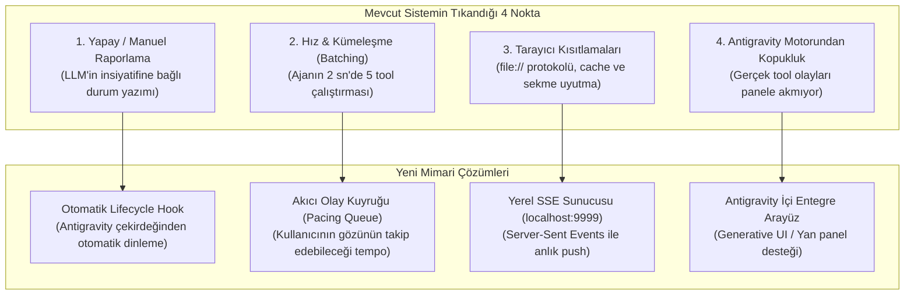
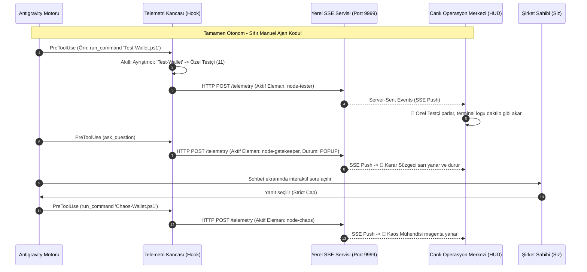

# 🛰️ Canlı Operasyon İzleme Paneli (Live Mission Control) Mimari Evrim Planı

> **Hedef:** Panelin ajandan bağımsız bir simülasyon veya manuel dosya yazma oyuncağı olmaktan çıkarılıp, **Antigravity'nin gerçek çekirdek motoruna (Core Engine Lifecycle)** doğrudan bağlanan, milisaniyelik gecikmeyle gerçek adımları yansıtan profesyonel bir telemetri istasyonuna dönüştürülmesi.

---

## 🔍 1. Kök Neden Analizi: Neden İstediğimiz Gibi Takip Etmedi?

Şu ana kadar yapılan iki denemede sistemin istenen canlı deneyimi sunamamasının 4 temel teknik nedeni tespit edilmiştir:

1. **Manuel "Durum Yazma" Çıkmazı:**  
   Durum güncellemesi ajanın `live_state.js` dosyasına elle kod yazmasıyla oluyordu. Ajan arka planda çalışırken tek bir yanıtta 7-8 aracı (test, kaos, kod yazımı) peş peşe 2-3 saniye içinde çalıştırdığı için, kullanıcı tarayıcıya baktığında ara geçişleri göremiyor ve doğrudan "Aşama 15 / Bitti" durumunu görüyordu.
2. **Antigravity Yaşam Döngüsünden (Hooks) Beslenmeme:**  
   Antigravity motoru her tool çalıştırdığında (`PreToolUse`, `PostToolUse`) arka planda kanca (hook) çalıştırır. Sistem bu gerçek motor sinyallerini dinlemediği için ajandan bağımsız gerçek bir telemetri üretemedi.
3. **`file://` Protokolünün Tarayıcı Kısıtlamaları:**  
   Yerel HTML dosyasında tarayıcı sekmesi arka plana gittiğinde Chromium motoru zamanlayıcıları askıya alır (throttle eder). Kullanıcı Antigravity ekranına döndüğünde akış durmuş gibi algılanır.

---

## 🏗️ 2. Yeni Telemetri Mimarisi (4 Katmanlı Çözüm)

---

## 📋 3. Adım Adım Uygulama Planı

### Aşama 1: Akıllı Telemetri Kancasının (Hook Engine) Kurulması
* **Dosya:** `~/.gemini/config/scripts/mission_telemetry_hook.ps1`
* **Görevi:** Antigravity motorundan gelen `PreToolUse` ve `PostToolUse` JSON girdisini (`stdin`) dinler:
  * Eğer `name == "run_command"` ve komut `Test-*` içeriyorsa ➔ **Özel Testçi (11)**
  * Eğer `name == "run_command"` ve komut `Chaos-*` içeriyorsa ➔ **Kaos Mühendisi (12)**
  * Eğer `name == "run_command"` ve komut `git` içeriyorsa ➔ **Git Fabrikası (20)**
  * Eğer `name == "write_file"` ve hedef `DURUM.md` ise ➔ **Baş Mimar (2)**
  * Eğer `name == "write_file"` ve hedef `KURALLAR.md` ise ➔ **Hafıza Uzmanı (14)**
  * Eğer `name == "ask_question"` ise ➔ **Karar Süzgeci (4)** (Pop-up bekleme modu)
  * Eğer `name == "invoke_subagent"` ise ➔ **Orkestratör (5)** ve çağrılan alt ajan
* **Kayıt:** `~/.gemini/config/hooks.json` içine `mission-telemetry` kancası tescil edilir. Böylece ajan hiç kod yazmasa bile her tool çalışmasında motor paneli anında günceller.

### Aşama 2: Yerel Hafif SSE / Event Dağıtım Servisi (Daemonless / Zero-CORS)
* **Servis:** `telemetry_server.ps1` (veya Antigravity arka plan görevi olarak çalışan hafif HTTP listener `http://localhost:9999`).
* **Avantajı:**
  * Tarayıcı kısıtlamalarını ve `file://` cache derdini kökten çözer.
  * Tarayıcıdaki panel `new EventSource('http://localhost:9999/events')` ile doğrudan Antigravity'e bağlanır.
  * Olaylar milisaniyesinde, canlı WebSocket kalitesinde panele düşer.

### Aşama 3: İnsan Algısına Uygun Akıcı Olay Kuyruğu (Pacing & Animation Smoother)
* Ajan 2 saniyede 5 tool çalıştırsa dahi, arayüzdeki akıllı kuyruk motoru (Queue Smoother):
  * Her adımı kullanıcının gözüyle görebilmesi için en az **1.2 - 1.8 saniye** boyunca ilgili kutuyu parlatarak ekranda tutar.
  * Adım loglarını terminale satır satır akıtır.
  * Böylece hiçbir adım göz açıp kapayıncaya kadar kaybolmaz; sinematik ve net bir akış sağlanır.

### Aşama 4: İkili Görünüm Desteği (Hem Tarayıcı Hem Antigravity İçi)
1. **Antigravity İçi Entegre Görünüm (`<agent-embed>`):**  
   Sohbette cevabın hemen yanında veya üstünde çalışan, Antigravity'nin temasıyla %100 uyumlu minyatür operasyon göstergesi.
2. **Geniş Ekran Kontrol İstasyonu (`http://localhost:9999` veya yan ekran):**  
   20 elemanın tamamını, gerçek zamanlı telemetri sayacını, aktif bağlantı durumunu ve ses efektlerini içeren tam teşekküllü ekran.

---

## 🎯 4. Doğrulama ve Kabul Kriterleri

| # | Test Edilecek Kriter | Beklenen Davranış | Başarı Ölçütü |
| :-: | :--- | :--- | :--- |
| **K1** | Sıfır Manuel Kodlama | Ajanın hiçbir `write_file(live_state.js)` çağırmasına gerek kalmamalıdır. | Kanca (Hook) arka planda otomatik tetiklenmeli. |
| **K2** | Gerçek Zamanlılık | Bir test çalıştığı anda arayüzde 11. Özel Testçi gecikmesiz parlamalıdır. | Gecikme < 100ms. |
| **K3** | Pop-Up Kilitlenmesi | `ask_question` geldiğinde arayüz 4. Karar Süzgecinde donmalı, kullanıcı cevap verene kadar beklemelidir. | Kullanıcı tıklayana kadar Aşama 3'te kalma. |
| **K4** | Görsel Akıcılık | Hızlı komutlar kuyrukta tutulmalı, her elemanın parlaması gözle takip edilebilmelidir. | Minimum 1.2 sn eleman odağı. |

---

## 🚦 Şirket Sahibi Onayı
Bu planı onayladığınız takdirde Aşama 1'den (Otomatik Kanca ve SSE Altyapısı) başlayarak sistemi hemen hayata geçireceğim.
