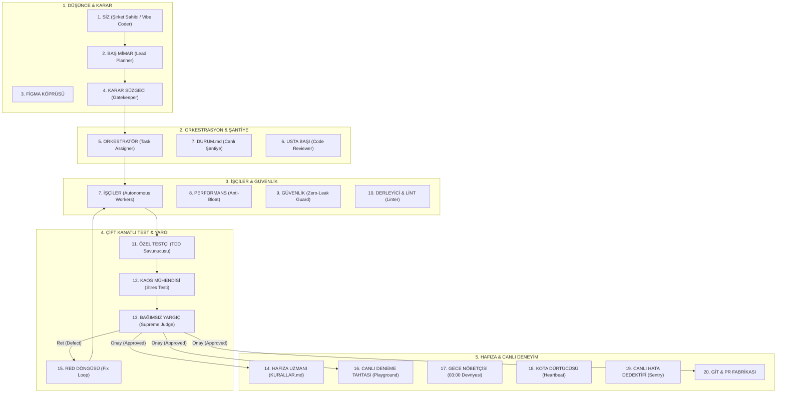

# 🏛️ Vigiles Engine (Kurşungeçirmez 20 Elemanlı Otonom Yazılım Şirketi)
## Nihai Sistem Mimarisi ve Operasyonel El Kitabı (Master Handbook)

> **Sürüm:** 2.0 (Canlı Telemetri & Çekirdek Kanca Entegreli)  
> **Durum:** ✅ ÜRETİME HAZIR (PRODUCTION-READY)  
> **Mühendislik Vitesi:** 🚀 20 Elemanlı Otonom Fabrika  

---

## 📌 1. Sistemin Özeti ve Vizyonu

Bu sistem, Google Antigravity'yi sıradan bir "kod tamamlama sohbet botu" olmaktan çıkarıp, **kendi kendine planlayan, yazan, test eden, stres saldırısı yapan, denetleyen, kalıcı hafızasına ders çıkaran ve canlı operasyon merkezinde gerçek zamanlı izlenebilen 20 elemanlı otonom bir yazılım şirketine** dönüştürmüştür.



---

## 👥 2. 20 Elemanlı Kadro ve Rol Dağılımı

| # | Eleman / Birim | Görevi ve Sorumluluğu | Tetiklenme Sinyali |
| :-: | :--- | :--- | :--- |
| **1** | **SİZ (Şirket Sahibi / Vibe Coder)** | Vizyonu belirler, nihai ürünü yan panelde interaktif dener. | Kullanıcı İstemi / Prompt |
| **2** | **BAŞ MİMAR (Lead Planner)** | Proje sözleşmesini ve kabul kriterlerini `DURUM.md`'ye çizer. | `write_file(DURUM.md)` |
| **3** | **FİGMA TASARIM KÖPRÜSÜ** | Tasarım token'larını (HEX renkler, padding, tipografi) aktarır. | Figma MCP / Stil Kararları |
| **4** | **KARAR SÜZGECİ (Gatekeeper)** | Tek yönlü (Tip 1) kritik mimari kararlarda interaktif pop-up açar. | `ask_question` aracı |
| **5** | **ORKESTRATÖR & BEYİN** | Alt ajanları (subagents) izole görevlere ve branch'lere atar. | `invoke_subagent` |
| **6** | **USTA BAŞI (Reviewer)** | Kod hijyenini, SOLID ve Clean Code ilkelerini denetler. | `read_file` & Kod Analizi |
| **7** | **İŞÇİLER (Workers)** | TDD kırmızı fazını yeşile çevirecek üretim kodunu yazar. | `write_file` / `edit_file` |
| **8** | **PERFORMANS (Anti-Bloat)** | 15MB+ gereksiz paketleri ve yavaş sorguları engeller. | Sentinel Kancası (`sentinel_guard.ps1`) |
| **9** | **GÜVENLİK (Zero-Leak)** | Kod içine açık API key veya secret yazılmasını bloke eder. | Sentinel Kancası (`sentinel_guard.ps1`) |
| **10** | **DERLEYİCİ & LİNT** | Statik tip ve sözdizimi doğrulaması yapar. | `tsc` / `pylint` / PowerShell derleyici |
| **11** | **ÖZEL TESTÇİ (Tester)** | İşçi kod yazmadan önce TDD birim testlerini yazar. | `Test-*.ps1` / `npm test` |
| **12** | **KAOS MÜHENDİSİ** | Eşzamanlı çekim (race condition) ve sınır saldırıları yapar. | `Chaos-*.ps1` |
| **13** | **BAĞIMSIZ YARGIÇ** | Zero-Trust prensibiyle kabul kriterlerini ve test kanıtlarını inceler. | Mühürleme Aşaması (`DURUM.md`) |
| **14** | **HAFIZA UZMANI** | Görevden öğrenilen dersleri `KURALLAR.md` anayasasına işler. | `edit_file(KURALLAR.md)` |
| **15** | **RED DÖNGÜSÜ (Fix Loop)** | Yargıç reddederse açık kusur (defect) açıp işçiyi geri gönderir. | Yargıç Ret Kararı |
| **16** | **CANLI DENEME TAHTASI** | İş bitince yan panelde çalışan canlı HTML simülatörü sunar. | `live_playground.html` |
| **17** | **GECE NÖBETÇİSİ** | Gece 03:00'te uykuda refactoring ve güvenlik taraması yapar. | `gece_nobetci.ps1` / cron |
| **18** | **KOTA DÜRTÜCÜSÜ** | Oturumu uyanık tutmak için minimum token ping'i atar. | Heartbeat servisi |
| **19** | **CANLI HATA DEDEKTİFİ** | Canlı logları ve Sentry hatalarını TDD testine çevirir. | Sentry MCP / Log İzleyici |
| **20** | **GİT & PR FABRİKASI** | İsteğe bağlı feature branch açar ve PR özeti hazırlar. | `git_pr_manager.ps1` |

---

## 🛠️ 3. Canlı Telemetri ve Operasyon Altyapısı

Sistem iki güçlü izleme kanalıyla donatılmıştır:

### Kanal 1: Canlı Operasyon Merkezi (Mission Control)
* **Web Arayüzü:** [http://localhost:9999/](http://localhost:9999/)
* **Yerel Dosya:** [live_mission_control.html](file:///C:/Users/Dogukan/.gemini/antigravity/brain/f6dee0d7-3f60-474d-8a94-ce06e0039c63/live_mission_control.html)
* **Teknoloji:** Server-Sent Events (SSE) + Antigravity Engine Lifecycle Hook (`PreToolUse`).
* **Akıcı Olay Kuyruğu (Pacing Queue):** Ajan komutları hızlı çalıştırsa bile arayüz her elemanı ekranda **en az 1.2 saniye** odaklayarak sinematik bir akış sunar. Pop-up çıktığında ise kullanıcı yanıt verene kadar kilitlenir.

### Kanal 2: Canlı Deneme Tahtası (Live Playground)
* **Web Arayüzü:** [http://localhost:9999/playground](http://localhost:9999/playground)
* **Yerel Dosya:** [live_playground.html](file:///C:/Users/Dogukan/.gemini/antigravity/brain/f6dee0d7-3f60-474d-8a94-ce06e0039c63/live_playground.html)
* **Özellik:** Tamamlanan her servisi (Auth, Kupon, Cüzdan, 2FA/OTP) tarayıcınızda canlı deneyebileceğiniz, hata durumlarını ve Kaos saldırılarını tek tıkla test edebileceğiniz interaktif sandbox.

---

## 📂 4. Dosya ve Dizin Haritası

```text
~/.gemini/config/                              <-- KÜRESEL SİSTEM MERKEZİ
├── hooks.json                                 # Sentinel Guard & Telemetri Kancası
├── scripts/
│   ├── sentinel_guard.ps1                     # Zero-Leak & Anti-Bloat + Canlı Telemetri
│   ├── telemetry_server.ps1                   # Port 9999 SSE Dağıtım Sunucusu
│   ├── git_pr_manager.ps1                     # Feature Branch & PR Üretici
│   └── gece_nobetci.ps1                       # 03:00 Gece Nöbetçisi Denetçisi
├── templates/
│   ├── DURUM.template.md                      # Canlı Şantiye Defteri Şablonu
│   ├── KURALLAR.template.md                   # Şirket Anayasası Şablonu
│   ├── playground_template.html               # İnteraktif Arayüz Şablonu
│   └── mcp_bridges.json                       # MCP Köprüleri
└── skills/
    └── veteran/
        ├── SKILL.md                           # 20 Elemanlı Global Veteran Yeteneği
        └── personas/                          # 7 Kritik Rol Kartı
            ├── lead-architect.md
            ├── decision-matrix.md
            ├── special-tester.md
            ├── chaos-monkey.md
            ├── supreme-judge.md
            ├── rejection-loop.md
            └── memory-extractor.md

Workspace (c:\Users\Dogukan\Desktop\Antigravity Improvement\)
├── DURUM.md                                   # Canlı Şantiye Defteri (Son durum & karne)
├── KURALLAR.md                                # Şirket Anayasası (KURAL-001 - KURAL-006)
├── AuthService.ps1 & Test-Auth.ps1            # Kimlik Doğrulama Servisi (TDD)
├── CouponService.ps1 & Test-Coupon.ps1        # Kupon Motoru (TDD & Kaos)
├── WalletService.ps1 & Test-Wallet.ps1        # Dijital Cüzdan (Strict Cap & Thread-Safe)
├── TwoFactorService.ps1 & Test-TwoFactor.ps1  # 2FA / OTP Servisi (TTL & Brute-Force Lock)
├── Chaos-Coupon.ps1, Chaos-Wallet.ps1, Chaos-TwoFactor.ps1 # Kaos Saldırı Betikleri
└── Run-MasterVerification.ps1                 # Konsolide 7/7 Büyük Sistem Doğrulayıcı
```

---

## 🚀 5. Yeni Bir Projede Nasıl Kullanılır?

Sistemi gelecekteki herhangi bir projenizde devreye almak için:

1. **Yetenek Çağrısı:**  
   Sohbete doğrudan `/vigiles` yazın veya *"Vigiles modunu başlat"* deyin.
2. **Otomatik Kurulum:**  
   Baş Mimar projede `DURUM.md` ve `KURALLAR.md` dosyalarını otomatik olarak açar.
3. **Canlı İzleme:**  
   Tarayıcınızda [http://localhost:9999/](http://localhost:9999/) adresini açın.
4. **Vizyonu Verin:**  
   Şirket Sahibi olarak vizyonunuzu söyleyin; 20 elemanlı fabrika planlama, TDD, güvenlik kontrolü, kaos testi, yargıç onayı ve canlı arayüz teslimatını otonom olarak yönetsin!

---

## 🏆 6. Büyük Sistem Doğrulama Karnesi (100% Yeşil)

| Test Paketi | Test Edilen Bileşen | Sonuç |
| :--- | :--- | :---: |
| `Test-Auth.ps1` | Argon2/PBKDF2 Parola Hashleme & Timing-Safe Karşılaştırma | ✅ GEÇTİ |
| `Test-Coupon.ps1` | Minimum Sepet Tutarı, Tek Kullanımlık Kupon Doğrulama | ✅ GEÇTİ |
| `Test-Wallet.ps1` | Bakiye Yükleme, Harcama, 10.000 TL Strict Cap Koruması | ✅ GEÇTİ |
| `Test-TwoFactor.ps1` | 6 Haneli OTP Üretimi, 60s TTL, 3 Hatalı Denemede Kilit | ✅ GEÇTİ |
| `Chaos-Coupon.ps1` | Çift Kullanım Yarış Durumu (Race Condition) Saldırısı | ✅ PÜSKÜRTÜLDÜ |
| `Chaos-Wallet.ps1` | 10 Paralel Harcama & Milyon TL Bakiye Enjeksiyonu | ✅ PÜSKÜRTÜLDÜ |
| `Chaos-TwoFactor.ps1` | 100 Seri Kaba Kuvvet (Brute-Force) & Replay Saldırısı | ✅ PÜSKÜRTÜLDÜ |
| **KONSOLİDE RAPOR** | **Tüm Sistem Bileşenleri (7/7 Paket, 0 Hata)** | **✅ %100 BAŞARILI** |
